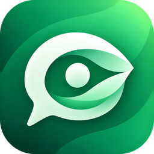
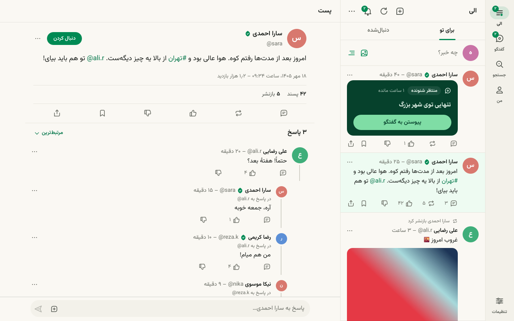
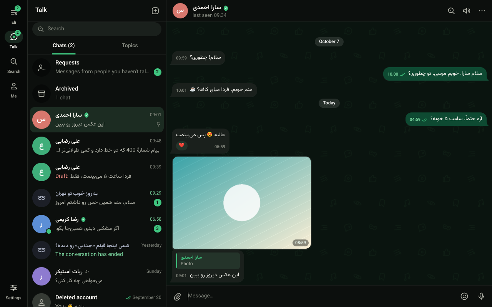

<div align="center">



# الزا دسکتاپ

**اپلیکیشن بومی الزا برای ویندوز و لینوکس**

سریع، سبک و کاملاً بومی — بدون مرورگر، بدون Electron.

</div>


## دربارهٔ الزا دسکتاپ

الزا دسکتاپ همهٔ الزا را روی کامپیوتر می‌آورد: پیام‌رسان، گفتگوی ناشناس و «الی». برنامه با
C++ و Qt نوشته شده و همهٔ رابط کاربری آن را موتور رابط اختصاصی الزا مستقیم نقاشی می‌کند؛
برای همین در چند لحظه باز می‌شود، حافظهٔ کمی می‌گیرد و فهرست‌های چندهزارتایی را روان اسکرول می‌کند.

## امکانات

**پیام‌رسان**
- چت خصوصی با متن، عکس، ویدیو، ویس، فایل، استیکر و موقعیت
- پاسخ و نقل‌قول، ویرایش، حذف برای هر دو طرف، واکنش، هدایت، سنجاق پیام
- اسپویلر برای متن و رسانه، پیش‌نمایش پیوند، پیش‌نویسِ همگام بین دستگاه‌ها
- ارسال با کشیدن و رها کردن یا چسباندن از کلیپ‌بورد، صف ارسال در حالت آفلاین
- سنجاق، بی‌صدا و بایگانی گفتگوها، درخواست‌های پیام، جستجو

**تماس صوتی**
- تماس دونفره با کاربران الزا روی اندروید، آیفون و دسکتاپ، از بالای گفتگو یا از نمایه
- زنگ تماس ورودی حتی وقتی پنجره بسته است؛ پاسخ با Enter و رد با Esc
- حذف نویز و پژواک، انتخاب میکروفون و بلندگو، بی‌صدا کردن و اتصال دوبارهٔ خودکار
- ثبت تماس‌ها در گفتگو و تماس دوباره با یک کلیک

**گفتگوی ناشناس**
- موضوع‌های باز با دسته‌بندی و زمان باقی‌مانده
- شروع گفتگوی تازه یا پیوستن به‌عنوان شنونده، با هویت پوشیده یا آشکار

**الی**
- فید «برای تو» و «دنبال‌شده»، پست متنی، تصویری، ویدیویی، صوتی، نظرسنجی و رشته
- پاسخ، بازنشر، نقل، ذخیره، موضوع‌ها و اعلان‌ها
- «پرده» برای تماشای پیوستهٔ ویدیوها

**و همچنین**
- جستجوی افراد، موضوع‌ها، پست‌ها و گفتگوها
- نمایه، دنبال‌کننده‌ها و ویرایش نمایه
- تأیید دومرحله‌ای، مدیریت دستگاه‌ها، حریم خصوصی و دریافت داده‌ها
- فارسی و انگلیسی، پوستهٔ روشن و تاریک، اعلان دسکتاپ، سینی سیستم و میان‌برهای صفحه‌کلید

<p>


</p>

## امنیت و حریم خصوصی

- **کلید دستگاه**: هر نصب کلید امضای خودش را می‌سازد و نشست به همان دستگاه گره می‌خورد؛ توکنِ
  کپی‌شده روی دستگاه دیگر کار نمی‌کند.
- **اتصال رمزگذاری‌شده**: علاوه بر TLS، اتصال پایدار برنامه یک لایهٔ رمزگذاری مستقل
  (Noise) دارد تا محتوای آن در میانهٔ مسیر خوانده نشود.
- **نگهداری امن**: اطلاعات ورود روی ویندوز با DPAPI محافظت می‌شود و با خروج از حساب، دادهٔ
  محلی پاک می‌شود.
- **تماس صوتی**: صدا رمزگذاری‌شده به سرور الزا می‌رسد و از همان‌جا به طرف مقابل؛ هیچ اتصال
  مستقیمی بین دو کاربر ساخته نمی‌شود و نشانی اینترنتی تو به طرف مقابل نمی‌رسد. تماس‌ها رمزنگاری
  سرتاسری ندارند و برنامه همین را در صفحهٔ تماس می‌گوید.
- **محتوای دریافتی**: تصویرها فقط در قالب‌های مجاز و با سقف اندازه باز می‌شوند، نام فایل‌ها
  پاک‌سازی می‌شود و پیوندهای بیرونی پیش از باز شدن تأیید می‌خواهند.

## فناوری

| | |
|---|---|
| زبان و چارچوب | C++20، Qt 6 Widgets، CMake |
| رابط کاربری | کتابخانهٔ رابط اختصاصی الزا؛ ویجت‌های خودنقاش، راست‌به‌چپ، HiDPI |
| استایل و متن‌ها | زبان استایل (`.style`) و فایل‌های ترجمه که هنگام بیلد به C++ تبدیل می‌شوند |
| ارتباط | اتصال پایدار روی WebSocket با protobuf و همگام‌سازی افزایشی؛ HTTP به‌عنوان پشتیبان |
| تماس صوتی | WebRTC از طریق کتابخانهٔ LiveKit؛ پردازش صدا (حذف نویز و پژواک) روی دستگاه |
| ذخیره‌سازی | SQLite برای کش آفلاین، کش رسانه با سقف حجم |
| آزمون | آزمون‌های واحد، آزمون سازگاری پروتکل و فازینگ ورودی‌ها |

## پلتفرم‌ها

- ویندوز ۱۰ و ۱۱ (x64)
- لینوکس (x86_64)

## بیلد از سورس

```sh
# لینوکس (Ubuntu 24.04)
sudo apt install cmake ninja-build g++ qt6-base-dev qt6-base-dev-tools qt6-svg-dev \
  qt6-multimedia-dev qt6-websockets-dev libqt6sql6-sqlite qt6-image-formats-plugins libssl-dev
cmake --preset linux-release
cmake --build --preset linux-release

# ویندوز (Visual Studio 2022، Qt 6.7 یا تازه‌تر، vcpkg)
cmake --preset windows-msvc-release
cmake --build --preset windows-msvc-release
```

راهنمای کامل: [docs/BUILDING.md](docs/BUILDING.md)

## مستندات

- [معماری](docs/ARCHITECTURE.md)
- [راهنمای توسعه](docs/DEVELOPING.md)
- [بیلد و بسته‌بندی](docs/BUILDING.md)

---

<div dir="ltr">

## Eleza Desktop

The native Eleza app for **Windows and Linux** — messaging, anonymous conversations and the Eli
feed in one fast, lightweight application with no browser engine inside.

Eleza Desktop is written in C++20 on Qt 6. Its entire interface is painted by Eleza's own UI
toolkit, so it starts instantly, stays light on memory and scrolls through thousands of messages
smoothly. It speaks Persian (right-to-left) and English, in light and dark.

**Highlights**

- **Messenger** — text, media, voice, files, stickers; replies and quotes, edits, reactions,
  forwarding, pins, spoilers, link previews, synced drafts, offline send queue.
- **Voice calls** — one-to-one calls with Eleza users on Android, iPhone and desktop: an
  incoming-call window that rings even when Eleza is closed to the tray, noise and echo removal,
  device selection, automatic reconnection, call history in the chat.
- **Anonymous conversations** — browse open topics, start one or join as a listener.
- **Eli** — For You and Following feeds, posts with media, polls and threads, notifications, topics.
- **Security** — device-bound sessions, an independently encrypted persistent connection on top
  of TLS, protected credential storage, strict handling of received files and links.

**Build**

```sh
cmake --preset linux-release && cmake --build --preset linux-release          # Linux
cmake --preset windows-msvc-release && cmake --build --preset windows-msvc-release   # Windows
```

See [docs/BUILDING.md](docs/BUILDING.md), [docs/ARCHITECTURE.md](docs/ARCHITECTURE.md) and
[docs/DEVELOPING.md](docs/DEVELOPING.md).

</div>

---

<div align="center">

© eleza — فونت‌ها: Vazirmatn و Markazi Text (SIL Open Font License)

</div>
