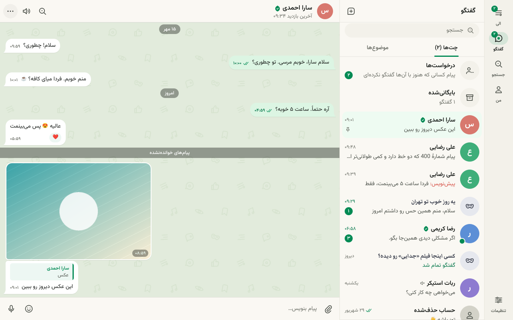

# Eleza Desktop — الزا دسکتاپ

کلاینت دسکتاپ الزا برای **ویندوز و لینوکس**؛ بومی، بدون مرورگر و بدون Electron.
از صفر و با همان دستور پخت تلگرام دسکتاپ نوشته شده: **C++20 + Qt 6 Widgets + CMake**، ویجت‌های
خودنقاش، و یک زبان استایل اختصاصی (`.style`) که هنگام بیلد به C++ تبدیل می‌شود. هیچ کدی از
کلاینت‌های دیگر در این ریپو نیست.



## چه چیزهایی دارد

- **ورود**: شماره (انتخاب کشور)، کد پیامکی، رمز دومرحله‌ای و بازیابی با ایمیل، تکمیل نمایه.
- **پیام‌رسان**: لیست چت (سنجاق، بی‌صدا، بایگانی، درخواست‌ها، پیش‌نویس، تایپینگ)، صفحهٔ چت به سبک
  تلگرام — همهٔ انواع پیام، پاسخ و نقل‌قول، ویرایش، حذف برای هر دو طرف، ری‌اکشن، هدایت، انتخاب
  چندتایی، اسپویلر، استیکر و ایموجی، ارسال فایل با کشیدن/چسباندن، ویس، سنجاق پیام، جستجو در چت،
  صف ارسال آفلاین.
- **گفتگوی ناشناس**: موضوع‌های باز، گفتگوی تازه، پیوستن، رادار، بنر و پایان/ادامه در چت.
- **الی**: فید «برای تو»/«دنبال‌شده»، همهٔ انواع کارت پست، جزئیات پست و رشته، نوشتن پست (رسانه،
  نظرسنجی، رشته)، اعلان‌ها، موضوع‌ها، ذخیره‌ها، «پرده».
- **جستجو، نمایه‌ها، تنظیمات** (حساب، دستگاه‌ها، دومرحله‌ای، حریم خصوصی، اعلان‌ها، ظاهر، حافظه).
- فارسی (راست‌به‌چپ) و انگلیسی، تم روشن/تاریک، اعلان دسکتاپ، سینی سیستم، میان‌برهای صفحه‌کلید.
- همان اتصال پایدار **realtime v2** (Noise NK + protobuf روی WebSocket) با fallback به HTTP.

هنوز نیست: تماس صوتی/تصویری، دوربین و فیلترها، HLS (ویدیو با mp4 پخش می‌شود)، ترنسپورت رله (T2).

## وضعیت

| | |
|---|---|
| لینوکس (GCC 13 و Clang 18، Qt 6.4) | بیلد و تست می‌شود |
| ویندوز (MSVC 2022، Qt 6.7+) | **هنوز روی ویندوز کامپایل نشده است**؛ کد با هدرهای ویندوز و Qt 6.7 بررسی نحوی شده و workflow آماده است |
| سرور | ورود با پلتفرم `desktop` به [eleza-backend#89](https://github.com/eleza-me/eleza-backend/pull/89) نیاز دارد |

## بیلد

جزئیات در [docs/BUILDING.md](docs/BUILDING.md).

```sh
# Linux (Ubuntu 24.04)
sudo apt install cmake ninja-build g++ qt6-base-dev qt6-base-dev-tools qt6-svg-dev \
  qt6-multimedia-dev qt6-websockets-dev libqt6sql6-sqlite qt6-image-formats-plugins libssl-dev
cmake --preset linux-release && cmake --build --preset linux-release
ctest --preset linux-release

# Windows (Visual Studio 2022 + Qt 6.7+ + vcpkg)
cmake --preset windows-msvc-release && cmake --build --preset windows-msvc-release
```

اجرا: `Eleza [--api=https://api.eleza.me] [--workdir=<dir>] [--lang=fa|en] [--theme=light|dark]`

## ساختار

```
codegen/        ابزارهای زمان بیلد: style و lang
lib/base        کمک‌کننده‌های بدون GUI
lib/ui          کتابخانهٔ UI: استایل، انیمیشن، ویجت‌ها، متن، لایه‌ها
Eleza/SourceFiles
  crypto api rt storage data main      هستهٔ بدون ویجت
  core window intro dialogs history conversation eli search profile settings boxes media support
tests/          تست‌های واحد، interop برای realtime، فازرها
```

راهنمای توسعه: [docs/ARCHITECTURE.md](docs/ARCHITECTURE.md) و [docs/DEVELOPING.md](docs/DEVELOPING.md).

---

## English

Native Eleza client for **Windows and Linux**, written from scratch with Telegram Desktop's recipe:
C++20, Qt 6 Widgets, CMake, custom-painted widgets and a small style language compiled at build
time. It covers sign-in, messaging, anonymous conversations, the Eli feed, search, profiles and
settings, in Persian (RTL) and English, light and dark, over the same realtime v2 connection as the
mobile and web clients. Not included yet: calls, camera and filters, HLS playback, the relay transport.

Linux builds and passes its tests. **The Windows build has not been compiled on Windows yet.**
Signing in needs the `desktop` platform on the server
([eleza-backend#89](https://github.com/eleza-me/eleza-backend/pull/89)).

Fonts: Vazirmatn and Markazi Text (SIL OFL, see `Eleza/Resources/fonts`).
